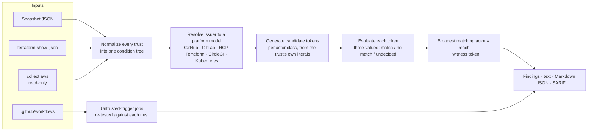

# TrustMint

[](https://github.com/ahmedhany-cys/trustmint/actions/workflows/ci.yml)
[](LICENSE)
[](pyproject.toml)

**Who can mint a token your cloud trusts?**

TrustMint audits OIDC workload identity federation: the trust relationships that let a
GitHub Actions job, a GitLab pipeline, an HCP Terraform run, a CircleCI job or a Kubernetes
pod become an AWS role, a Google service account or an Entra app without a stored secret.
For every trust it works out **which class of actor could obtain a token that satisfies
it**, and proves the answer with a concrete *witness token*: the claims that actor would
present, which the trust's own conditions accept.

It runs offline against a JSON snapshot, a `terraform show -json` plan (so it can block a
bad trust before it is applied), or a read-only collection from an AWS account. It also
reads GitHub workflow files to find jobs where an untrusted trigger can mint those tokens.

```text
$ trustmint scan -s examples/acme/snapshot.json -w acme/payments-api=examples/acme/workflows/payments-api
TrustMint 0.1.0: 20 federation trusts from examples/acme/snapshot.json
Workflow jobs with id-token: write: 2
Findings: 11 critical, 7 high, 3 medium, 1 low, 4 info

WHO CAN MINT A TOKEN EACH IDENTITY ACCEPTS
  PUBLIC     analytics-reader@acme-prod.iam.gserviceaccount.com    gcp   <- github     read
  PUBLIC     arn:aws:iam::111122223333:role/gh-ci-readonly         aws   <- github     read
  PUBLIC     arn:aws:iam::111122223333:role/gh-release-main        aws   <- github     write
  PUBLIC     projects/acme-artifacts                               gcp   <- gitlab     write
  TENANT     arn:aws:iam::111122223333:role/gh-org-admin           aws   <- github     admin
  TENANT     platform-automation                                   azure <- github     admin
  PROJECT    arn:aws:iam::111122223333:role/tfc-prod-network       aws   <- terraform  admin
  PROJECT    deployer@acme-prod.iam.gserviceaccount.com            gcp   <- github     admin
  PROTECTED  arn:aws:iam::111122223333:role/gh-payments-immutable  aws   <- github     write
  NONE       arn:aws:iam::111122223333:role/gh-web-broken          aws   <- github     write
  ...
```

*Real output from the synthetic Acme estate in [examples/acme](examples/acme). The full
report is in [examples/acme/report.md](examples/acme/report.md). Every account, project and
ID in it is made up.*

---

## Contents

1. [The problem](#the-problem)
2. [What TrustMint does differently](#what-trustmint-does-differently)
3. [How it works](#how-it-works)
4. [Reach levels](#reach-levels)
5. [Rules](#rules)
6. [Quick start](#quick-start)
7. [Inputs](#inputs)
8. [Using it in CI](#using-it-in-ci)
9. [A worked example](#a-worked-example)
10. [What it models](#what-it-models)
11. [Testing](#testing)
12. [Security design](#security-design)
13. [Limitations](#limitations)
14. [Research and references](#research-and-references)
15. [License](#license)

---

## The problem

Moving CI/CD from long-lived cloud keys to OIDC federation is the right call, and most
teams have done it. The risk moved with it. A federation trust is a short JSON condition,
and small mistakes in it are easy to make and hard to see:

- **Leaving out the subject check.** A role that checks only `aud = sts.amazonaws.com`
  accepts a token from *any* GitHub repository in the world. Datadog Security Labs reported
  hundreds of roles like this across hundreds of AWS accounts, and Tinder's security team
  found it was the most common mistake in their own review.
- **Wildcards one character too wide.** `repo:acme*` also matches the organization
  `acme-evil`, which anyone can register. `repo:acme/*` lets every repository in the org
  in, including one an intern creates tomorrow.
- **Pinning the branch, then running untrusted code on it.** A `pull_request_target` job
  that checks out the pull request runs with the base repository's identity, so its token
  says `ref:refs/heads/main`. A perfectly pinned trust then belongs to anyone who can open a
  pull request.
- **Trusting names that can be reused.** Bindings on `attribute.repository/acme/app` keep
  working for whoever owns that name next. GitHub introduced immutable subjects in 2026 for
  exactly this reason, and trusts written for the old format will also *stop* working as
  repositories migrate.
- **Different syntax everywhere.** The same intent is AWS `StringLike`, Google CEL, an Entra
  subject or a flexible claims expression, over GitHub, GitLab, Terraform, CircleCI and
  Kubernetes token formats. Reviewing all of that by hand does not scale.

Existing open-source checks cover one slice, typically "AWS role trusts GitHub without a
`sub` condition". TrustMint answers the general question across clouds and CI platforms.

## What TrustMint does differently

- **It answers "who", not "is there a wildcard".** Each trust gets a reach level, from
  *anyone on the CI platform* down to *protected refs only*, with the actor named in plain
  language.
- **It proves findings with witness tokens.** A finding is reported only when TrustMint can
  build a token that the trust's own condition evaluator accepts. The witness is in the
  report, so anyone can check it.
- **It models the token formats and who controls each part.** The owner, repository, ref,
  environment, plan/apply phase or namespace, and which of them an outsider, an org member
  or a contributor can choose. The job picks the audience, so `aud` is never treated as a
  security boundary.
- **It evaluates the real condition languages.** AWS operators (including `IfExists`,
  `ForAllValues`, `Null`, Deny statements), a CEL subset for Google attribute mappings and
  conditions, and Entra classic and flexible credentials.
- **It says "undecided" instead of guessing.** Constructs it does not model (a CEL function
  it does not implement, an `aws:SourceIp` key) make the answer a lower bound, reported as
  such.
- **It connects workflows to trusts.** A `pull_request_target` job with `id-token: write` is
  matched against every GitHub trust it can satisfy.

## How it works



1. **Normalize.** AWS trust statements, Google provider mappings, conditions and IAM
   bindings, and Entra credentials are turned into one expression tree over token claims.
2. **Resolve the issuer.** `token.actions.githubusercontent.com` is GitHub's shared issuer;
   `.../acme-enterprise` is an enterprise-only one; a CircleCI or EKS issuer belongs to one
   organization or cluster. Shared issuers can be reached by outsiders, dedicated ones only
   from inside.
3. **Build candidate tokens.** For each actor class the platform model builds tokens that
   actor could really obtain. Wildcards in the trust are filled with attacker-chosen text,
   so `repo:acme*` yields a token from an organization called `acmeattacker`. Impossible
   values, such as branch names containing `:`, are not used.
4. **Evaluate and rank.** The broadest actor whose token passes is the reach. Among equal
   matches the most readable witness is kept.
5. **Extra checks.** The witness is re-minted with new owner and repository IDs to test for
   name reuse (TM005), checked against the immutable GitHub subject format (TM010), and
   workflow jobs on untrusted triggers are matched against every trust (TM004).

More detail, including each platform's token model and the evidence behind it, is in
[docs/how-it-works.md](docs/how-it-works.md).

## Reach levels

| Reach | Who can mint a matching token | Example trust |
|---|---|---|
| **PUBLIC** | Anyone who can sign up to the CI platform | GitHub trust with no `sub`; `repo:acme*`; GitLab `namespace_path.startsWith('acme')` |
| **TENANT** | Any member of the owning org, group or cluster, from a repo/project/namespace the trust never named | `repo:acme/*`; `system:serviceaccount:*` |
| **PROJECT** | Anyone who can run a pipeline in the trusted repo on an unprotected ref: push a branch, open a same-repo PR, queue a plan | `repo:acme/infra:*`; `run_phase:*`; `system:serviceaccount:payments:*` |
| **PROTECTED** | Only protected branches, tags, environments, apply runs, or one service account | `repo:acme/app:environment:production` |
| **NONE** | No token TrustMint built satisfies it: a dead or broken trust | `StringEquals` with a `*` in it |
| **UNDECIDED** | The condition uses constructs TrustMint does not model | an `aws:SourceIp` condition, CEL `extract()` |

Severity combines reach with a rough privilege level of the identity (read, write, admin)
read from attached policies, roles or role assignments. A PUBLIC trust is always critical.

## Rules

| ID | Finding | Severity |
|---|---|---|
| TM001 | Anyone on the CI platform can assume this identity | critical |
| TM002 | Any repository or project in the organization can assume it | high, critical if admin |
| TM003 | Unprotected branches, pull requests or plans can assume it | medium, high if write/admin |
| TM004 | A workflow with an untrusted trigger can mint a token it accepts | critical if PR code runs, else medium |
| TM005 | Bound to names someone else could take over (subject recycling) | low, medium if admin |
| TM006 | No token satisfies the trust (dead or broken) | info |
| TM007 | Issuer is not a CI platform TrustMint models | info, high if unconditional |
| TM008 | Trust could not be fully evaluated | info |
| TM009 | A workflow runs untrusted code with `id-token: write` | high |
| TM010 | Trust only accepts name-based GitHub subjects | info |

Each rule is explained, with fixes, in [docs/rules.md](docs/rules.md).

## Quick start

```bash
git clone https://github.com/ahmedhany-cys/trustmint.git
cd trustmint
python -m venv .venv && source .venv/bin/activate
pip install -e .
```

Run the built-in scenarios (39 trusts with known answers), then scan the demo estate:

```bash
trustmint selfcheck
```

```bash
trustmint scan -s examples/acme/snapshot.json -w acme/payments-api=examples/acme/workflows/payments-api
```

See why one trust got its reach, step by step:

```bash
trustmint explain -s examples/acme/snapshot.json gh-release-main
```

```text
arn:aws:iam::111122223333:role/gh-release-main
  condition sub like 'repo:acme*:ref:refs/heads/main'
  audience  aud == 'sts.amazonaws.com'
  privilege write (inline policy release-artifacts: write)
  ladder (broadest first):
    PUBLIC     MATCH  28/252 tokens, e.g. sub='repo:acmeattacker@87330698/attacker@54139022:ref:refs/heads/main'
               minted by whoever owns or registers the GitHub account or organization `acmeattacker`
    TENANT     MATCH  18/108 tokens, e.g. sub='repo:acme@34701011/attacker@19180486:ref:refs/heads/main'
    PROJECT    no     0/40 tokens, e.g. rejected sub='repo:acme/data-pipeline:ref:refs/heads/tm-probe-branch'
    PROTECTED  MATCH  10/20 tokens, e.g. sub='repo:acme/web:ref:refs/heads/main'
```

Other commands: `trustmint rules`, `trustmint collect aws`, `trustmint assemble`.
Formats: `-f text|json|markdown|sarif`. Exit code 1 when a finding at or above
`--fail-on` (default `high`) exists, 2 on bad input.

## Inputs

**Snapshot JSON.** One file can hold AWS roles and OIDC providers, Google providers and IAM
policies, and Entra identities with their federated credentials, in the shapes the cloud
CLIs already print. The format is documented in
[docs/snapshot-format.md](docs/snapshot-format.md).

**Terraform plans.** `terraform show -json plan.out > plan.json`, then
`trustmint scan -p plan.json`. TrustMint reads `aws_iam_role`,
`aws_iam_openid_connect_provider`, policy attachments, `google_iam_workload_identity_pool_provider`,
`google_service_account_iam_*`, `google_project_iam_*`,
`azuread_application_federated_identity_credential` and `azurerm_federated_identity_credential`,
including resources in child modules. Values Terraform cannot know until apply are listed
as skipped, never guessed.

**Live AWS (optional, read-only).**

```bash
pip install -e '.[aws]'
```

```bash
trustmint collect aws --profile audit -o aws-snapshot.json
```

It calls only `iam:List*`/`iam:Get*` and `sts:GetCallerIdentity`; the AWS managed
`SecurityAudit` policy is enough. Google and Azure are collected with their own CLIs and
combined with `trustmint assemble` (commands in the snapshot docs).

**Context (optional but recommended).** Tell TrustMint what you own, so findings rest on
facts instead of inference:

```json
{
  "owners": ["acme"],
  "repos": ["acme/payments-api"],
  "protected_refs": {"acme/payments-api": ["main", "production"]},
  "issuers": {"https://ghe.acme.internal/_services/token": {"platform": "github", "scope": "tenant"}}
}
```

When owners are declared, a trust that pins `repo:acme-tools/app` is flagged, because
`acme-tools` is not yours and may belong to anyone. Without a context file, owners and
repositories are inferred from each trust's literals, and every finding says so in its
assumptions.

## Using it in CI

The repository is also a composite GitHub Action that scans and uploads SARIF to code
scanning:

```yaml
permissions:
  contents: read
  security-events: write
jobs:
  trustmint:
    runs-on: ubuntu-latest
    steps:
      - uses: actions/checkout@v4
      - run: terraform init && terraform plan -out plan.out && terraform show -json plan.out > plan.json
      - uses: ahmedhany-cys/trustmint@v0.1.0
        with:
          terraform-plan: plan.json
          workflows: ${{ github.repository }}=.
          fail-on: high
```

## A worked example

The Acme snapshot contains 20 trusts across the three clouds. A few that show what the
model catches:

- **`gh-release-main`** trusts `repo:acme*:ref:refs/heads/main`. It looks pinned to `main`,
  but the missing `/` lets any organization whose name starts with `acme` in. Reach PUBLIC,
  witness `repo:acmeattacker/attacker:ref:refs/heads/main`.
- **`analytics-reader@`** is bound to a whole Google pool (`principalSet://.../github-pool/*`).
  The pool has two providers: one with `assertion.repository_owner == 'acme'` (TENANT) and a
  legacy one with no condition (PUBLIC). One weak provider opens every pool-wide binding.
- **`gh-payments-immutable`** is pinned exactly, to the immutable subject on `main`. On its
  own it is PROTECTED. But `pr-preview.yml` runs on `pull_request_target`, checks out the
  pull request and has `id-token: write`, so TM004 reports it as reachable by anyone who can
  open a pull request.
- **`tfc-prod-network`** (AdministratorAccess) accepts `run_phase:*`. Anyone who can queue a
  plan gets admin; the fix is a read-only plan role.
- **`projects/acme-artifacts`** grants a Google project role to the whole GitLab pool, whose
  condition is `namespace_path.startsWith('acme-group')`. A GitLab group called
  `acme-groupattacker` satisfies it.
- **`deployer@`** is bound to `attribute.repository/acme/data-pipeline`. Any branch can use
  it (TM003), and because the `repository` claim is name-based, whoever takes the name next
  inherits it (TM005).
- **`gh-web-broken`** uses `StringEquals` with `repo:acme/web:*`. The `*` is literal, so the
  trust can never match (TM006), which usually means a deployment is failing or a stale
  role is lying around.

## What it models

| | AWS IAM | Google Cloud | Microsoft Entra |
|---|---|---|---|
| Trust | role trust policy, `AssumeRoleWithWebIdentity` | provider mapping + attribute condition + IAM binding | classic and flexible federated credentials |
| Language | `String*`, `*IgnoreCase`, `*Like`, `Null`, `IfExists`, `ForAnyValue`/`ForAllValues`, Deny | CEL subset: `== != in && || !`, `+`, `startsWith endsWith contains matches size has` | exact subject; `eq`, `matches`, `and`, `or` |
| Audience | provider client ID list | allowed audiences or the provider default | credential audiences |
| Privilege | managed and inline policies | roles held by the service account, binding role | role assignments |

| CI platform | Subject model | Shared issuer? |
|---|---|---|
| GitHub Actions | `repo:O/R:ref:…`, `:environment:…`, `:pull_request`, immutable `O@ID/R@ID`, plus `repository`, `ref`, `job_workflow_ref` and ID claims | yes (enterprise issuers are not) |
| GitLab CI | `project_path:G/…/P:ref_type:…:ref:…`, `ref_protected`, `namespace_path` | gitlab.com yes, self-managed via context |
| HCP Terraform | `organization:O:project:P:workspace:W:run_phase:plan\|apply` | yes |
| CircleCI | `org/O/project/P/user/U`, `vcs-ref`, `context-ids`; audience is the org ID | no, per organization |
| Kubernetes / EKS | `system:serviceaccount:NS:SA` | no, per cluster |

## Testing

```bash
pip install -e '.[dev]'
```

```bash
ruff check src tests && pytest && trustmint selfcheck
```

- **42 unit and integration tests** cover the condition engine's three-valued logic, the
  CEL subset (including error absorption in `&&`/`||`), each cloud parser, Terraform plan
  conversion, workflow parsing, every CLI command and format, and the AWS collector against
  stubbed IAM responses.
- **39 selfcheck scenarios** ([src/trustmint/scenarios](src/trustmint/scenarios)) pin down
  semantics with known answers: AWS operator edge cases and Deny statements, issuer scoping,
  CEL conditions and bindings, Entra flexible expressions.
- **Witness soundness**: a test re-evaluates every reported witness against its trust and
  audience, so a finding cannot be reported without a token that really passes.
- CI runs all of it on Python 3.11 to 3.14, and scans the demo estate as an end-to-end check.

The whole demo estate (20 trusts, 3,622 candidate tokens) is analysed in about 30 ms on a
laptop.

## Security design

- **Offline by default.** `scan`, `explain` and `selfcheck` make no network calls. Only
  `collect aws` talks to a cloud, and only with read-only IAM calls.
- **No credentials handled.** TrustMint never asks for or stores tokens or keys; the AWS
  collector uses the standard boto3 credential chain.
- **Safe parsing.** YAML is read with `safe_load`; JSON with the standard library. CEL and
  Entra expressions are parsed by small hand-written parsers, never `eval`.
- **No exploitation.** Witness tokens are claim sets for explanation. TrustMint does not sign,
  request or present tokens anywhere.
- **Honest output.** Findings carry their assumptions (for example "assumes `main` is
  protected"); undecidable parts are reported as such.

## Limitations

- **A witness search, not a proof of safety.** A match is a real token that works. "No
  match" means none of the candidates TrustMint built works; unusual subject formats can
  still hide a path.
- **Custom GitHub subject templates** (`include_claim_keys`) are not modeled yet; trusts
  written for them will usually show as NONE.
- **Protection is assumed, not read.** Branch protection, rulesets and environment
  protection rules come from the context file or are assumed for `main`/`master` and refs
  pinned exactly; TrustMint does not call the GitHub API.
- **CEL and Entra expressions** are subsets. Unsupported constructs make the trust
  UNDECIDED rather than wrong.
- **Privilege is a rough level** from policy names and actions, used only to rank severity.
  Use an IAM analyzer such as
  [aws-cloud-attack-path-analyzer](https://github.com/ahmedhany-cys/aws-cloud-attack-path-analyzer)
  for what the identity can actually reach.
- **Not modeled:** SAML federation, Cognito identity pools, AWS-type Google providers,
  CircleCI V2 subjects, GitLab environment-scoped subjects, EKS Pod Identity (which does not
  use OIDC trust policies), and Bitbucket or Buildkite issuers (they show as TM007).
- **Platform facts change.** The GitHub immutable-subject behaviour reflects GitHub's April
  2026 changelog and Microsoft's July 2026 migration guide; the dates are in
  [docs/how-it-works.md](docs/how-it-works.md).

## Research and references

- GitHub Changelog, [Immutable subject claims for GitHub Actions OIDC tokens](https://github.blog/changelog/2026-04-23-immutable-subject-claims-for-github-actions-oidc-tokens) (April 2026)
- Microsoft Learn, [Migrate GitHub Actions federated credentials to immutable subjects](https://learn.microsoft.com/entra/workload-id/workload-identities-github-immutable-subjects) (July 2026)
- GitHub Docs, [Configuring OpenID Connect in Amazon Web Services](https://docs.github.com/actions/deployment/security-hardening-your-deployments/configuring-openid-connect-in-amazon-web-services)
- HashiCorp, [Workload identity tokens](https://developer.hashicorp.com/terraform/cloud-docs/workspaces/dynamic-provider-credentials/workload-identity-tokens)
- Tinder Security, [Identifying vulnerabilities in GitHub Actions & AWS OIDC configurations](https://lifeattinder.com/blog/identifying-vulnerabilities-in-github-actions-aws-oidc-configurations)
- Datadog Security Labs' research on GitHub OIDC roles without subject conditions, as
  summarized in [this write-up](https://dev.to/haitmg/i-audit-aws-accounts-8-out-of-10-have-this-github-actions-backdoor-4g9k)
- Cloud Security Alliance, [Top Threats to Cloud Computing 2026](https://cloudsecurityalliance.org/artifacts/top-threats-to-cloud-computing-2026)
  (inadequate identity and access management, including federated trust, ranked first)

## License

[MIT](LICENSE). Contributions are welcome; see [CONTRIBUTING.md](CONTRIBUTING.md).
